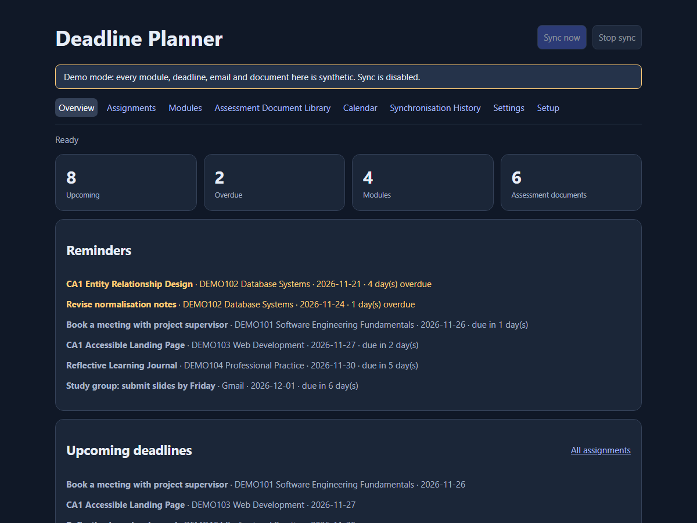
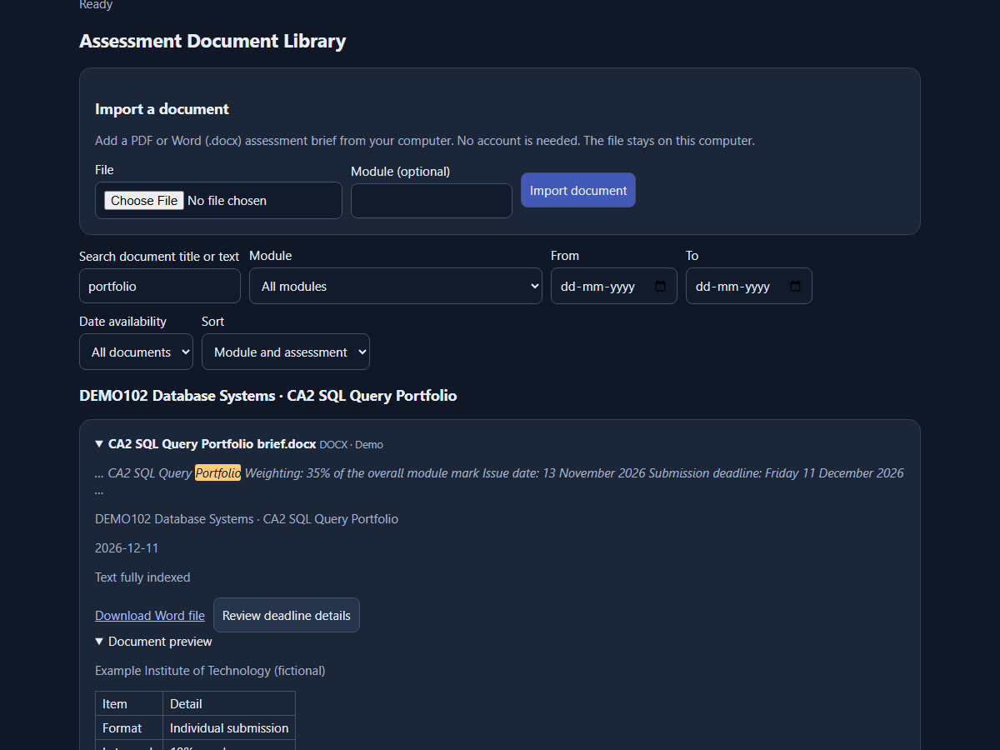
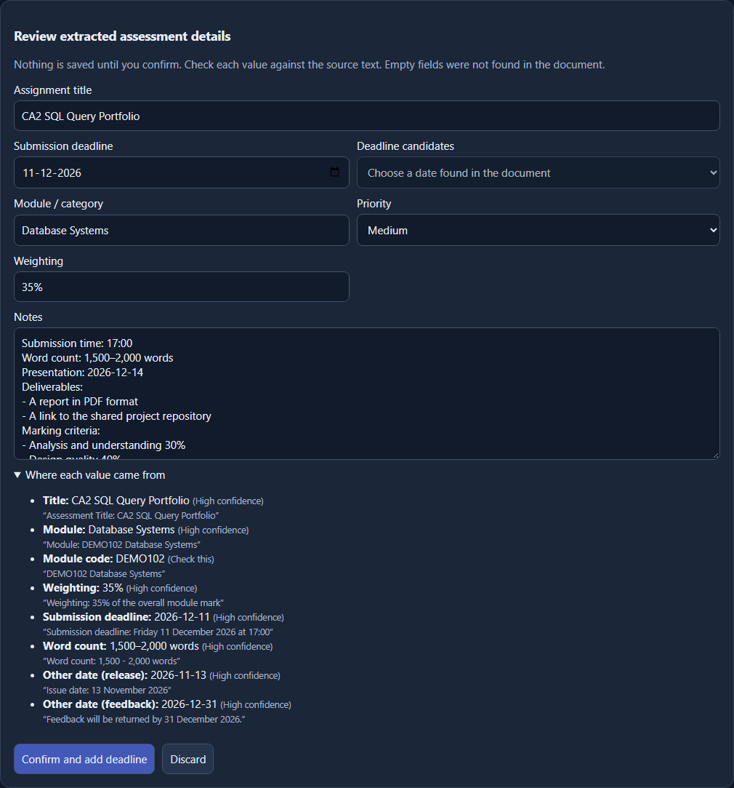
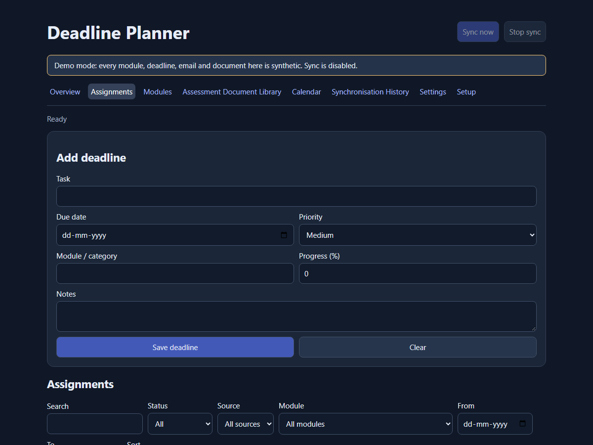
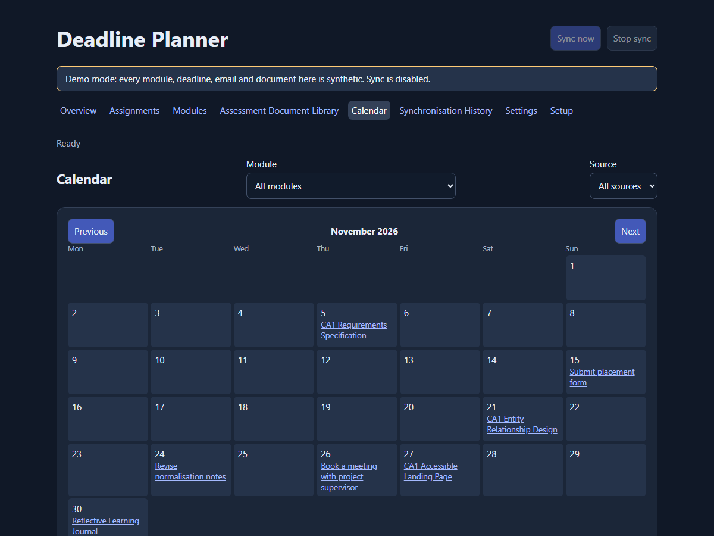
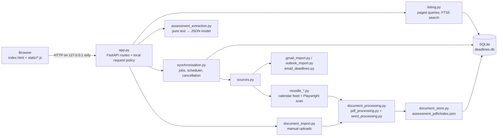

# Deadline Planner

A single-user, local-first deadline planner for students. It collects assessment
deadlines from Moodle, Outlook, Gmail and your own PDF or Word assessment briefs,
keeps them in a local SQLite database and shows them on a dashboard that runs at
`http://127.0.0.1` on your own computer.



> **Unofficial project.** Deadline Planner is not affiliated with, endorsed by or
> supported by Moodle, Microsoft, Google or any educational institution. You are
> responsible for using it within your institution's acceptable-use policies and the
> terms of each service you connect. Some institutions do not allow automated access
> to their Moodle site. If in doubt, ask first, or use only manual imports.

## What it is, and what it is not

| It is | It is not |
| --- | --- |
| A personal productivity tool for one person | A hosted or multi-user service |
| Self-hosted: you run your own copy on Windows | A cloud product with accounts or subscriptions |
| Local-first: data stays in files on your computer | Connected to any server run by the author |
| Usable with no accounts at all (manual entry and file imports) | Dependent on an AI service or API key |

## The problem

Assessment deadlines arrive through several channels: the Moodle calendar, assignment
pages, attached briefs, and email announcements. Briefs are often PDFs or Word files
where the submission date sits next to issue dates, presentation dates and feedback
dates. Deadline Planner brings these into one list, extracts likely deadlines from
briefs with the source text shown, and asks you to confirm anything uncertain.

## Main features

- **Dashboard** with upcoming and overdue counts, reminders, recent documents and a
  month calendar.
- **Assignments** with manual entry, editing, progress, priority, and search plus
  filters by status, source, module and date range. Pages of 10, 25 or 50 records.
- **Document library** for PDF and DOCX assessment briefs:
  - manual import from your computer, with no account needed;
  - structured Word previews (headings, lists, tables, headers and footers);
  - extraction completeness indicators (fully indexed, partly indexed, no text);
  - optional local OCR for scanned PDFs using Tesseract;
  - duplicate prevention by SHA-256 content hash;
  - SQLite FTS5 full-text search with highlighted excerpts.
- **Assessment extraction**: title, module name and code, weighting, submission date
  and time, presentation dates, word count, deliverables, marking criteria and
  instructions, each with source text and a confidence level. Irish and European date
  formats are read day-first. Ambiguous deadlines always need your confirmation.
- **Optional integrations**:
  - Moodle: calendar export feed and a signed-in scan of courses, assignment pages
    and assessment files (Playwright, using your own saved browser session);
  - Outlook (Microsoft Graph, read-only) and Gmail (read-only) for explicit deadline
    wording in recent mail. Email deadlines are flagged for review.
- **Synchronisation** with incremental downloads (unchanged files are skipped), a
  date-range filter, a preview before downloading, cancellation, and a history log.
- **Reminders** for deadlines inside a chosen number of days, with optional browser
  notifications while the planner is open.
- **Data management**: preview-then-confirm clearing of imported data, duplicate
  cleanup and full reset, with an automatic SQLite backup first.
- **Demo mode** with entirely synthetic modules, deadlines, emails and documents.

## Screenshots

All screenshots use the synthetic demo data.

| Library with search and Word preview | Reviewing extracted details |
| --- | --- |
|  |  |
| **Assignments** | **Calendar** |
|  |  |

## Technology

Python 3.11+, FastAPI, Uvicorn, SQLite (with FTS5 when available), plain HTML, CSS and
JavaScript modules (no build step), Playwright for Moodle, pypdf for PDFs, a streaming
XML reader for DOCX, MSAL for Outlook, and Google API client libraries for Gmail.
Development uses pytest, Ruff, ESLint and Prettier.

## Architecture



Design choices worth knowing:

- **Code and data are separate.** The project folder holds only source code. Your
  personal data lives in `data/` (or `PLANNER_DATA_DIR`): `.env`, the database, sign-in
  sessions, tokens, documents, backups and logs. Demo mode uses `demo-data/` instead,
  which is how it stays isolated. Copies installed before this layout had their data
  in the project folder; `run_server.py` moves it into `data/` once, never
  overwriting anything (`data_location.py`).
- **Extraction is pure.** `assessment_extraction.py` takes text and returns a
  JSON-compatible dictionary. It has no I/O and no third-party imports, so it can be
  ported to JavaScript for the planned [Chrome extension](CHROME_EXTENSION_PLAN.md).
- **One operation at a time.** Syncs, uploads and data maintenance share an in-process
  lock and an OS file lock, so two writers never touch the document index together.
- **The file index is the durable record.** `assessment_pdfs/index.json` is written
  atomically first. SQLite holds a searchable copy that is reconciled on startup.

## Project structure

| Location | Responsibility |
| --- | --- |
| `app.py` | FastAPI routes, validation and the local request policy |
| `run_server.py` | Single-instance launcher bound to 127.0.0.1, used by `start.ps1` |
| `configuration.py`, `data_location.py`, `local_files.py` | Settings, the data folder and its one-time migration, logging, atomic writes and file locks |
| `database.py`, `task_identity.py`, `data_management.py` | Schema migrations, imports, task identity, confirmed maintenance and backups |
| `listing.py`, `search_index.py` | Paginated queries, filters, FTS5 index and triggers |
| `assessment_extraction.py` | Text to assessment data model (see [docs/assessment-data-model.md](docs/assessment-data-model.md)) |
| `document_processing.py`, `pdf_processing.py`, `word_processing.py` | Validated PDF and DOCX text extraction, completeness flags, OCR |
| `document_import.py`, `document_store.py` | Manual uploads and the document index |
| `synchronisation.py`, `sync_runtime.py`, `sources.py`, `source_http.py` | Jobs, scheduler, cancellation and provider adapters |
| `moodle_details.py`, `moodle_discovery.py`, `moodle_documents.py`, `moodle_http.py`, `moodle_urls.py` | Moodle scan |
| `gmail_import.py`, `outlook_import.py`, `email_deadlines.py`, `auth.py` | Email providers and interactive authorisation |
| `demo_data.py`, `synthetic_documents.py` | Synthetic demo data and test documents |
| `index.html`, `planner.js`, `static/` | Frontend |
| `setup.ps1`, `start.ps1`, `stop.ps1` | Windows installation and process control |
| `scripts/` | Release packaging, benchmark and README screenshot capture |
| `tests/` | Automated tests; `tests/fixtures/extraction_cases.json` holds the shared extraction cases |
| `docs/` | Assessment data model, JSON Schema and screenshots |
| `data/` | Your personal data (created by `setup.ps1`, never committed) |

## Installation (Windows)

Requirements: Windows 10 or 11, [Python 3.11 or later](https://www.python.org/downloads/windows/)
and an internet connection for the first install. Administrator rights are not needed.

```powershell
git clone https://github.com/<your-account>/deadline-planner.git
cd deadline-planner
.\setup.ps1
```

`setup.ps1` checks the Python version, creates `.venv`, installs the pinned
dependencies (falling back to compatible ranges if your Python release cannot use the
pins), installs Playwright Chromium for Moodle, and prepares `data/`: folders, a `.env`
copied from `.env.example` if none exists, and the database. It is safe to run again
and keeps existing files. Use `-SkipBrowser` to skip the Chromium download and `-Dev` to add the
test tools.

If PowerShell says *running scripts is disabled on this system*, use the matching
`.cmd` launcher instead: `.\setup.cmd`, `.\start.cmd -Open`, `.\stop.cmd`. Each one
runs its `.ps1` script with a bypass for that single command only, so Windows'
execution policy setting is left unchanged. To allow local scripts permanently for your
own account instead, run `Set-ExecutionPolicy -Scope CurrentUser RemoteSigned`.

## Quick start

```powershell
.\start.ps1 -Open      # start in the background and open http://127.0.0.1:8000
.\stop.ps1             # stop this project's server only
```

`start.ps1` refuses to start a second copy for the same data folder. Use
`-Foreground` to run in the current window and `-Port` to choose another port.
`stop.ps1` asks the server to shut down using a private token; it only ends a process
it can confirm is this project's `run_server.py`, and never touches other Python
processes.

On first launch, open **Setup** to choose integrations and reminder preferences. You
can skip all integrations and start adding deadlines or importing briefs immediately.

## Demo mode

```powershell
.\start.ps1 -Demo -Open    # http://127.0.0.1:8001
.\stop.ps1 -Demo
```

Demo mode builds `demo-data/` with fictional modules, assignments, weightings,
completed work, email-style notifications and generated PDF and Word briefs. Dates
are relative to today so there is always something upcoming and overdue. Sync and
integration changes are disabled. The builder refuses to write into any folder that
contains non-demo data, so it cannot overwrite a personal database. Rebuild it with
`.\.venv\Scripts\python.exe demo_data.py --reset`.

## Configuration

Settings come from `data\.env` (integrations) and from the app (preferences). Edit
them on the **Setup** page or in `data\.env`.

| Setting | Purpose |
| --- | --- |
| `MOODLE_URL` | Your Moodle address or a signed-in page such as the dashboard |
| `MOODLE_ICS_URL` | Private calendar export URL. Treat it as a password |
| `MOODLE_TIMEZONE` | IANA timezone for calendar times, for example `Europe/Dublin` |
| `OUTLOOK_CLIENT_ID`, `OUTLOOK_TENANT` | Microsoft Entra app for read-only mail access |
| `SYNC_MINUTES` | Initial automatic sync interval. Saved settings override it |
| `PLANNER_DOCUMENT_OCR` | `true` to OCR text-less PDF pages with local `pdftoppm` and `tesseract` |
| `PLANNER_DOCUMENT_MAX_TEXT_CHARS`, `PLANNER_DOCUMENT_MAX_PDF_PAGES` | Extraction limits |
| `PLANNER_DATA_DIR` | Use a different data folder (environment variable, not `.env`) |
| `PLANNER_PORT` | Default port for `run_server.py` |
| `PLANNER_LOG_LEVEL` | Local log level, `INFO` by default |

### Moodle

Set `MOODLE_URL` (and optionally `MOODLE_ICS_URL`), then save a sign-in session:

```powershell
.\.venv\Scripts\python.exe auth.py moodle
```

Sign in (including MFA) in the browser that opens, leave the dashboard open and press
Enter. The session is saved to `moodle-session.json`. Then click **Sync now**. Use
**Settings → Preview available imports** to see matching records and documents before
downloading. If the status asks you to sign in again, rerun the command.

### Outlook

Register an app in Microsoft Entra with public client flows enabled and the delegated
Microsoft Graph `Mail.Read` permission. Enter its client ID and tenant on **Setup**,
then run `.\.venv\Scripts\python.exe auth.py outlook` and follow the device sign-in.
Your organisation may require IT approval.

### Gmail

In Google Cloud, enable the Gmail API, configure the OAuth consent screen and create a
**Desktop app** OAuth client. Save the JSON as `credentials.json` in the `data`
folder, then run `.\.venv\Scripts\python.exe auth.py gmail`. Access is read-only.

To disconnect a source, delete its local token or session file and revoke access in
the provider's account settings.

## Supported documents

| Format | Support |
| --- | --- |
| PDF | Text extraction up to 200 pages and 100,000 characters (configurable). Encrypted PDFs are stored but not indexed. Scanned pages need optional local OCR |
| DOCX | Body text, headings, lists, tables, headers and footers |
| DOC, DOCM | Not supported. Macro-enabled files are rejected |

Files are limited to 30 MB, identified by their content rather than their name, and
stored under their SHA-256 hash. Macros and embedded objects are never opened.

## API

Interactive documentation is served locally at
[http://127.0.0.1:8000/docs](http://127.0.0.1:8000/docs). Main endpoints:

| Method and path | Purpose |
| --- | --- |
| `GET /api/overview` | Dashboard counts, next deadlines and recent documents |
| `GET /api/tasks?page=1&size=25&q=&status=&source=&module=&start=&end=&sort=` | Paged, filtered deadlines |
| `POST /api/tasks`, `PUT /api/tasks/{id}`, `DELETE /api/tasks/{id}?confirmed=true` | Manual deadlines. `document_id` links a confirmed deadline to its brief |
| `GET /api/assessment-documents?page=1&q=...` | Paged documents with FTS snippets and extraction status |
| `POST /api/assessment-documents/upload?filename=brief.pdf&module=` | Raw PDF or DOCX body with a document `Content-Type` |
| `GET /api/assessment-documents/{id}/pdf` or `/docx` | The stored original |
| `GET /api/assessment-documents/{id}/preview` | Structured preview blocks |
| `GET /api/assessment-documents/{id}/extraction` | Suggested assessment details (not saved) |
| `GET /api/reminders` | Deadlines inside the reminder window |
| `GET/PUT /api/preferences` | Reminder and first-run preferences |
| `GET/PUT /api/setup` | Integration status and `.env` settings. Secrets are never returned |
| `GET/PUT /api/settings` | Sync scope: sources, modules, date range, schedule |
| `POST /api/sync`, `/api/sync/preview`, `/api/sync/download`, `/api/sync/stop` | Synchronisation jobs |
| `GET /api/sync/history`, `GET /api/status` | Job history and live status |
| `POST /api/data/preview`, `POST /api/data/apply` | Confirmed data management and reset |

The extraction result format is documented in
[docs/assessment-data-model.md](docs/assessment-data-model.md) with a JSON Schema.

## Testing

```powershell
.\setup.ps1 -Dev
.\.venv\Scripts\python.exe -m pytest -q          # runs tests/
.\.venv\Scripts\python.exe -m ruff check .
.\.venv\Scripts\python.exe -m ruff format --check .
npm ci; npm run lint; npm run format:check    # requires Node.js 24+
```

Tests use temporary databases, synthetic documents and mocked providers. No real
Moodle, Outlook or Gmail account is used. The Chromium dashboard test skips itself if
Playwright Chromium is not installed. GitHub Actions runs the same checks on Windows
and Linux; there is no deployment pipeline because there is nothing central to deploy.

## Performance

`scripts/benchmark.py` builds a synthetic library and times searches with and without
the FTS5 index. Measured on the author's Windows laptop with Python 3.15 and SQLite
3.53 (5,000 tasks, 500 documents of about 3,000 words, median of 15 runs):

| Search | FTS5 | Substring fallback |
| --- | --- | --- |
| Tasks, common word | 14.7 ms | 23.6 ms |
| Tasks, rare word | 8.8 ms | 22.2 ms |
| Documents, rare word (446 matches) | 36.9 ms | 51.7 ms |
| Documents, no match | 1.6 ms | 58.4 ms |

A 9-page PDF took about 15 ms to extract, a DOCX about 2 ms, and assessment extraction
about 10 ms. Results vary by machine; run the script to measure your own. FTS5 matches
whole words and word prefixes; the substring fallback is used automatically if your
SQLite build has no FTS5, or when a query contains no letters or digits.

## Security and privacy

- The server binds to `127.0.0.1` only and accepts only `127.0.0.1` and `localhost`
  host names, which blocks DNS-rebinding attacks.
- State-changing requests with a foreign `Origin` are rejected. Uploads require a
  document `Content-Type`, which a web page cannot send cross-site without a CORS
  preflight that the server never approves. Responses send `nosniff`,
  `no-referrer` and `X-Frame-Options: DENY`.
- There are no user accounts. Anything running as your Windows user can reach the
  local API, as with any local desktop tool.
- Documents and imported web or email content are treated as untrusted data: size and
  page limits, content sniffing, DTD rejection for Word XML, no macros, no embedded
  objects, and HTML-escaped rendering. Files are served only by generated hash names,
  never by user-supplied paths.
- The calendar URL is never returned by the API. Provider errors are logged by type,
  not by message, to avoid writing private URLs to logs.
- Keep the `data/` folder private: it holds `.env`, `credentials.json`,
  `moodle-session.json`, `gmail-token.json`, `outlook-cache.json`, `deadlines.db`,
  documents, backups and logs. `.gitignore` excludes it and every one of those names.

## Known limitations

- Windows is the supported platform for the scripts. The Python code runs on Linux in
  CI, but there are no Linux or macOS launch scripts.
- Moodle scanning depends on your site's theme and permissions. Custom layouts or
  restricted activities can limit results. Sync uses your own session and is subject
  to your institution's rules.
- Extraction is rule-based and English-language. Unusual layouts, dates without a
  year, and Irish-language month names are not recognised and are left for you.
- Scanned PDFs need the optional OCR tools. Legacy `.doc` files are not supported.
- Reminders and browser notifications only appear while the planner is open.
- Cancellation takes effect at the next checkpoint after an in-flight request ends.
- Deleting an imported deadline in the planner can be undone by the next sync, because
  the source still contains it. Use Data management and disable automatic sync instead.

## Roadmap

- A separate Chrome extension for briefs, without the Python backend
  ([plan](CHROME_EXTENSION_PLAN.md)).
- Calendar (ICS) export of confirmed deadlines.
- Better table-aware extraction for marking rubrics.
- Optional Linux and macOS launch scripts.

## Upgrading an existing copy

Stop the planner (`.\stop.ps1`), back up your data folder, replace the source files
and run `.\setup.ps1`. New tables (the full-text index and preferences) are added in
place on the next start, and existing data is kept. If your data is still in the
project folder from an early development version, it is moved into `data/` at that
point without overwriting anything.

## Publishing a clean copy

Development history can contain private files, so publish from a fresh source build
with a new Git history rather than from a working folder.

```powershell
.\scripts\New-SourceRelease.ps1 -Force
```

The script copies only the allow-listed source files to
`dist\deadline-planner-<version>\` and a zip, refuses links, and stops if it finds a
likely secret, personal path or email address. Test the zip in an empty folder
(`.\setup.ps1 -Dev -SkipBrowser`, then `pytest`, then `.\start.ps1 -Demo`). Then,
inside the release folder:

```powershell
git init -b main
git add .
git status     # check: no .env, .db, sessions, tokens, documents or logs
git commit -m "Deadline Planner 1.0.0"
git tag -a v1.0.0 -m "Deadline Planner 1.0.0"
git remote add origin https://github.com/<account>/<new-repository>.git
git push -u origin main
git push origin v1.0.0
```

Create the GitHub repository empty (no README, licence or .gitignore). Use the
CHANGELOG entry as the release text.

## Licence

MIT. See [LICENSE](LICENSE). Third-party dependencies keep their own licences (MIT,
BSD and Apache-2.0); none are bundled in this repository.
